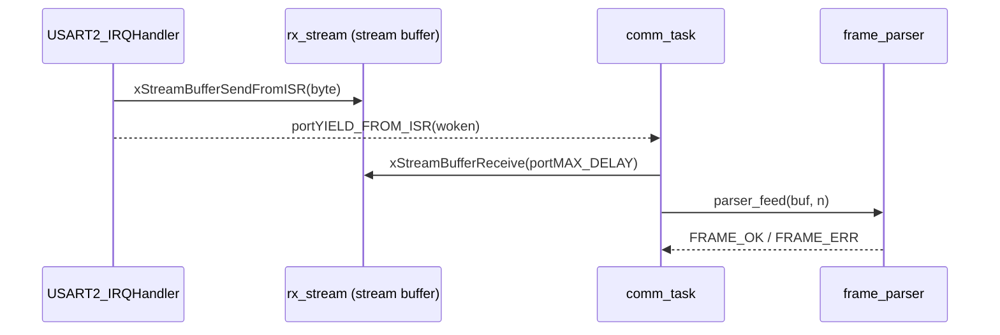
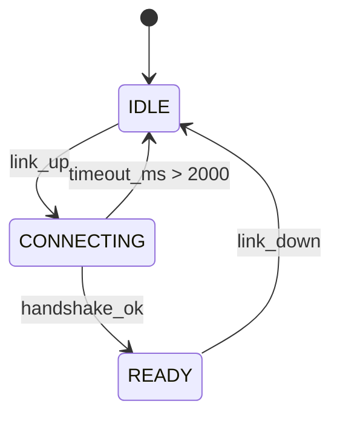
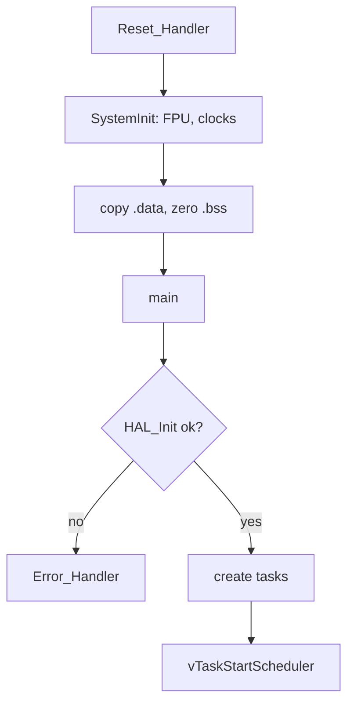

# Mermaid diagrams for firmware

## Rules
- Derive diagrams from the code (Grep the real function/state names), never from assumptions; note anything inferred.
- One diagram = one question (e.g. "how does a UART byte reach the parser?"). Keep it under ~25 nodes; split otherwise.
- Use exact identifiers from code in labels; quote labels containing `()`, `[]`, `:` or `/`: `A["HAL_UART_RxCpltCallback()"]`.
- Output a fenced ```mermaid block in the reply. Save to a file (`docs/diagrams/<topic>.md`) only when the user asks.
- Optional render check (free): `npx -y @mermaid-js/mermaid-cli -i x.mmd -o x.svg` (or `mmdc` if installed).

## Pick the diagram type
| Question | Type |
|---|---|
| Who talks to whom over time (ISR -> queue -> task -> driver) | `sequenceDiagram` |
| Protocol / mode / connection logic | `stateDiagram-v2` |
| Init sequence, algorithm, error handling | `flowchart TD` |
| Module/layer dependencies, task map | `flowchart LR` with subgraphs |
| MCU and external parts from a schematic | `flowchart LR` (blocks + buses as edge labels) |

## Templates



For tasks, annotate priority and stack (`comm_task<br/>prio 3, 2 KB`) taken from the `xTaskCreate` calls.
